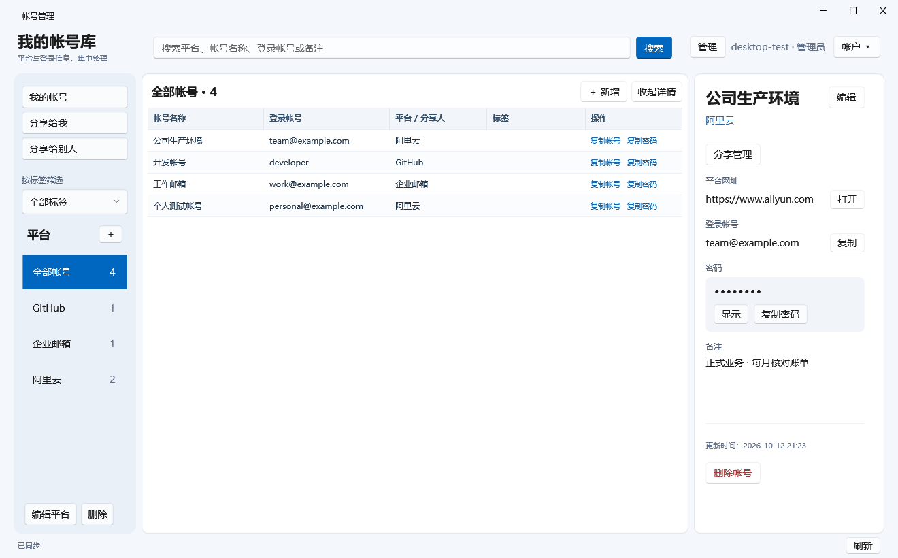
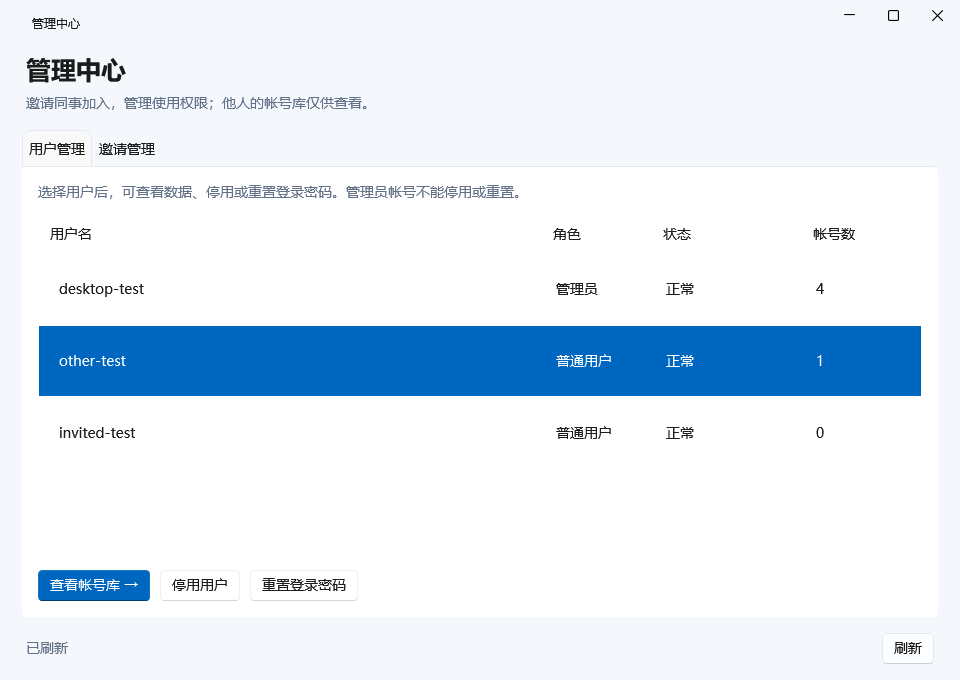

# AccountManagement · 平台帐号管理

[](LICENSE)


一个面向个人与小团队的自托管平台帐号管理工具。通过 Windows 桌面应用集中整理平台、登录帐号、密码和备注，通过钉钉企业内部 H5 微应用随时查找、复制和管理分享，由独立 Java 服务与 MySQL 保存数据。

适合“一个平台有多个帐号，需要快速查找和复制”的使用场景。支持单帐号多接收人分享、彩色标签、Windows 自动更新，以及[钉钉 H5 绑定与免登](mobile/README.md)。首次验证现有帐号密码并绑定钉钉身份，之后从钉钉进入自动登录，仍可使用密码登录。

现有部署中，Windows 自动更新已完成实际升级验证；钉钉 H5 及绑定免登已由使用者反馈运行正常。具体 Android/iOS、钉钉版本及 HTTPS 状态未在此记录，不表示所有环境均已验收。

**权限设计：管理员可以查看所有用户保存的平台帐号和密码。** 普通用户管理自己的数据，也可只读访问明确分享给自己的帐号。本项目不采用管理员无法解密的零知识设计。部署前请让使用者了解这一权限边界。

## 界面预览

平台、紧凑帐号表格、详情三栏布局，支持行内复制帐号/密码、收起详情，以及彩色标签摘要：



管理员用户管理：



以上截图由本地测试生成，内容均为虚构测试数据。

## 功能

| 模块 | 已实现能力 |
|---|---|
| 帐号库 | 一个平台保存多个帐号；新增、编辑、删除；平台网址与备注 |
| 查找 | 按平台筛选；跨平台搜索平台名、帐号名、登录帐号和备注 |
| 单帐号分享 | 多接收人只读授权；“分享给我”查看及复制密码；“分享给别人”集中管理接收人及撤销授权 |
| 彩色标签 | 自定义名称、六种颜色、同用户复用；多标签展示与单标签筛选 |
| 密码操作 | 默认隐藏；显示与复制；切换帐号或窗口失去焦点后隐藏 |
| 注册与登录 | 邀请制注册；7 天会话；修改登录密码；多设备登录 |
| 邀请管理 | 一次性邀请码，7 天有效；手动发放与撤销 |
| 用户管理 | 停用、恢复、重置临时密码；重置后强制改密并撤销旧会话 |
| 管理员查看 | 他人帐号库只读查看；不能修改或删除他人的平台与帐号 |
| 审计 | 记录管理操作、分享授权/撤销，以及管理员和接收人显示/复制密码；后端支持审计查询 |
| 钉钉 H5 | 三个帐号入口、搜索及平台/标签筛选、查看/复制密码、分享管理、修改登录密码 |
| 钉钉免登 | 首次密码验证绑定；之后钉钉身份登录；支持密码回退和解绑，遵循停用、锁定及强制改密规则 |
| 网络 | 可配置 HTTP 监听地址；支持 HTTP / HTTPS；Apache 或 Nginx 反向代理；H5 同域 API 与精确来源校验 |
| Windows 更新 | Velopack 安装包；启动检查、下载及确认重启；自托管更新源，发布签名和安装包哈希验证 |

不支持离线密码库、浏览器自动填充或自动修改第三方平台密码。编辑保存的密码只会更新本工具中的记录。

Windows 提供帐号、平台维护和管理员功能。H5 当前侧重查找、复制与分享，暂不提供帐号/平台编辑、邀请注册和管理员操作；批量分享仅记录需求，尚未实施。

## 技术栈与结构

| 部分 | 技术 |
|---|---|
| Windows 客户端 | C#、.NET 10、WPF、CommunityToolkit.Mvvm、WPF UI |
| 钉钉 H5 | 原生 HTML/CSS/JavaScript、钉钉 JSAPI；静态部署，无需生产 Node.js 运行时 |
| 后端 | Java 8、JDK HttpServer、Gson、JDBC |
| 数据库 | MySQL，独立 utf8mb4 数据库；现有环境已验证核心流程兼容 MySQL 5.5.34 |
| 测试 | Java HTTP/JDBC 集成测试、H2 测试库、WPF 视图模型与独立进程退出测试 |

```text
Windows 客户端 ── HTTP 或 HTTPS 代理 ────────┐
钉钉 H5 ── Apache 静态页面 + 同域 API 代理 ──┤── Java API → MySQL
                                           └── 后端向钉钉验证免登身份
```

当前 H5 提供 Apache 配置示例，也可按同域路径要求适配 Nginx；仓库不会自动改动服务器配置。客户端不直接连接数据库，钉钉 AppSecret 仅保存在后端。

```text
AccountManagement/
├── desktop/           Windows 客户端、构建脚本与测试
├── mobile/            钉钉 H5、静态发布脚本与 Apache 配置示例
├── backend/           Java API、配置示例与部署说明
├── database/          按序执行的数据库脚本
├── probes/            Java / MySQL 环境兼容性探针
├── docs/images/       项目界面截图
├── 需求文档.md         已确认需求、规划与验收标准
├── THIRD_PARTY_NOTICES.md
└── LICENSE
```

## 从源码构建

当前构建脚本使用 PowerShell，建议在 Windows 上构建；后端生成的 JAR 可部署到 Linux。

准备以下工具：

- Git、PowerShell（建议 PowerShell 7）。
- JDK 8，编译和后端测试均需使用。
- .NET SDK **10.0.401** 或同一特性带的更新补丁，版本策略见 [global.json](desktop/global.json)。
- 首次构建需要访问 Maven Central 和 NuGet 下载依赖。

```powershell
git clone https://github.com/shjmqqc/AccountManagement.git
cd AccountManagement

$repo = (Get-Location).Path
$jdk = 'C:\Program Files\Java\jdk1.8.0_192' # 改为本机 JDK 8 目录
$dotnet = (Get-Command dotnet).Source

# 编译后端，运行核心、管理、分享及钉钉绑定测试，生成部署包
& "$repo/backend/build.ps1" -Jdk $jdk

# 编译客户端，运行隔离联调和进程退出测试
& "$repo/desktop/test.ps1" -Jdk $jdk -Dotnet $dotnet

# 发布携带 .NET 运行时的 Windows x64 包
& "$repo/desktop/publish.ps1" -Dotnet $dotnet

# 打包 H5 静态文件（无需 npm 安装或前端编译）
& "$repo/mobile/publish.ps1"
```

每一步成功后再执行下一步。`-Dotnet` 用于指定已安装的 SDK；仓库不包含脚本默认使用的 `.tools/dotnet`。

| 产物 | 用途 |
|---|---|
| `backend/build/account-management-core.zip` | 后端 JAR、运行依赖、配置示例与部署文档 |
| `desktop/artifacts/AccountManagement-win-x64.zip` | Windows x64 自包含客户端 |
| `desktop/artifacts/previews/` | 测试生成的界面预览 |
| `mobile/artifacts/account-management-mobile.zip` | H5 的 HTML、JavaScript、CSS 静态文件 |

客户端需**完整解压**后运行 `AccountManagement.exe`，不能只复制 EXE。使用发行包无需另装 .NET。目标为 Windows 10/11 x64，目前本机验证环境为 Windows 11；Windows 10 的具体版本及 DPI 表现仍需实机验证。

## 部署与连接

首次部署请按 [后端部署说明](backend/README.md) 操作，流程为：

1. 使用 [001-create-database.sql](database/001-create-database.sql) 创建独立数据库。
2. 依次执行 [002-core-schema.sql](database/002-core-schema.sql)、[003-admin-schema.sql](database/003-admin-schema.sql)、[004-sharing-tags.sql](database/004-sharing-tags.sql)，创建核心、管理、分享及标签表。
3. 创建专用数据库用户，复制配置示例并填写数据库密码、密钥路径和监听地址。
4. 生成一次加密密钥，初始化首位管理员，再启动后端。
5. 在客户端填写服务地址，使用初始化的管理员帐号登录并邀请同事。

**已有部署不要重跑建库、建表或密钥生成命令。** 按当前已部署功能执行缺少的增量脚本：[管理功能 003](backend/UPGRADE.md)、[分享与标签 004](backend/SHARING-UPGRADE.md)。启用钉钉免登还需执行 [005-dingtalk.sql](database/005-dingtalk.sql)，更新后端并填写钉钉配置，见[钉钉免登升级说明](backend/DINGTALK-UPGRADE.md)。已执行的脚本不重复执行。数据库备份与原密钥都应妥善保留，否则可能无法解密已有密码。

现有 `config.properties` 的监听配置：

```properties
http.host=0.0.0.0
http.port=18082
```

- 直接访问：客户端填写 `http://服务器IP:18082`，安全组与防火墙需允许对应端口。
- 本机访问或 SSH 隧道：后端可配置 `http.host=127.0.0.1`；未设置 http.host 时也采用此默认值。
- HTTPS 代理：客户端填写 `https://你的域名`；同机 Apache 或 Nginx 可代理到 `http://127.0.0.1:18082`。

`0.0.0.0` 是监听地址，不是客户端连接地址。当前允许 HTTP，但其链路不加密；通过公网传输真实密码时应使用 HTTPS。

配置和密钥就绪后，在后端部署目录启动：

```bash
java -Xms16m -Xmx128m -cp 'account-management.jar:lib/*' accmgr.Main serve config.properties
```

没有默认管理员密码。工具登录帐号、Linux 帐号与 MySQL 帐号是不同的帐号。

H5 部署见 [移动端说明](mobile/README.md)：上传三个静态文件、配置 `/accmgr-api/` 同域转发和 `http.browserOrigin`，再将页面地址设置为钉钉内部应用首页。免登默认关闭；启用时将 CorpId、ClientId、ClientSecret 写入后端配置，不写入网页。绑定选项在钉钉内打开且后端已启用免登时显示。

## 数据与权限

- 登录密码使用带随机盐的 PBKDF2-HMAC-SHA256 保存，无法读取原文；平台密码使用 AES-256-GCM 加密保存。
- 加密密钥独立于数据库存放。具备服务端密钥与相应数据访问能力的一方具有解密能力。
- 后端校验记录所有者；管理员查看和授权分享通过各自的只读接口读取他人数据。接收人不能修改、删除或再次分享。
- 分享无到期时间；所有者撤销后禁止后续读取，已显示或复制的内容无法收回。停用所有者期间暂停其分享，授权保留。
- 修改或重置登录密码会撤销该用户全部旧会话，但不会重新加密或丢失已保存的平台密码。
- Windows 登录令牌由当前用户的 DPAPI 保护；不保存离线帐号库。用户主动复制的内容会进入系统剪贴板。
- H5 令牌保存在当前页面的 sessionStorage；钉钉免登由后端验证授权码并映射到已有系统用户，不自动创建帐号或提升权限。解绑需验证密码，并撤销该帐号所有现有会话。
- 不要提交真实 `config.properties`、密钥、数据库备份、密码或访问令牌。

Java 8 / MySQL 5.5 的兼容设计源于现有部署环境，不意味着建议新项目采用停止维护的系统或数据库。H2 测试不能替代目标 MySQL 环境的兼容性验证，当前项目也不应被视为经过独立安全审计的密码管理产品。

## 开发计划

以下功能尚未实现，具体规则见 [需求文档](需求文档.md)：

- [ ] 批量分享（已记录需求，暂不实施）。
- [ ] H5 帐号/平台维护及邀请注册。
- [ ] 完善 HTTPS 部署及 Android/iPhone、钉钉版本兼容性验证记录。
- [ ] Windows 审计查询页面、备份恢复流程完善。

## 文档与贡献

- [Windows 使用、构建与验证](desktop/README.md)
- [Windows 自动更新发布与首次安装](desktop/自动更新部署.md)
- [钉钉 H5 部署与使用](mobile/README.md) · [绑定免登升级](backend/DINGTALK-UPGRADE.md)
- [后端部署](backend/README.md) · [接口文档](backend/API.md) · [数据库说明](database/README.md)
- [客户端验证记录](desktop/验证记录.md) · [管理接口验证记录](backend/管理接口验证记录.md) · [分享与标签验证记录](backend/分享与标签验证记录.md)
- [需求与验收标准](需求文档.md)

欢迎通过 [Issues](https://github.com/shjmqqc/AccountManagement/issues) 反馈问题，或提交 Pull Request。报告问题时请提供系统版本、复现步骤和去除敏感信息后的错误信息；不要上传真实密码、令牌、邀请码、密钥或数据库备份。涉及密码泄露的安全问题，请先通过维护者提供的私密渠道沟通，避免在公开 Issue 中披露可利用的细节。

提交改动时说明解决的问题、影响范围与验证方式。涉及后端行为时运行 `backend/build.ps1`；涉及客户端时运行 `desktop/test.ps1`。截图与演示请使用虚构数据。

## 许可证

项目自身代码采用 [MIT License](LICENSE)，Copyright (c) 2026 shjmqqc。使用、修改和分发时请保留许可证与版权声明。

第三方依赖按各自许可证授权，不因本项目采用 MIT 而改变。特别是 MySQL Connector/J 使用其上游许可证；完整依赖说明见 [THIRD_PARTY_NOTICES.md](THIRD_PARTY_NOTICES.md)。
